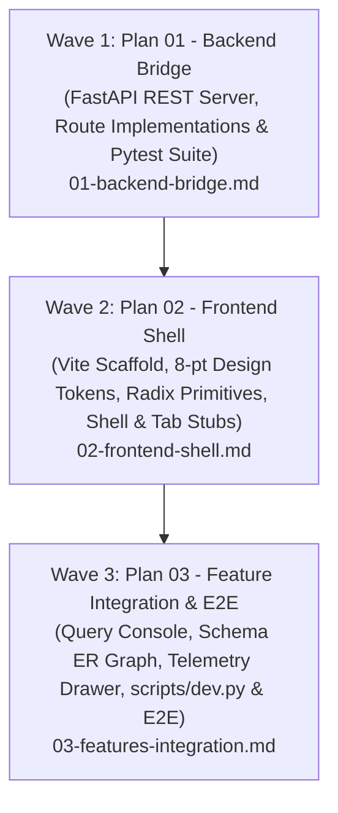

# UI Phase Master Plan: DataMind Enterprise React Cockpit & FastAPI Bridge

## Phase Overview

DataMind is transitioning from a prototype Streamlit script into a high-performance, enterprise-grade React Single Page Application (SPA) with a FastAPI backend REST bridge.

This phase strictly implements the approved UI specification (`UI-SPEC.md`), enforcing:
- **Strict 8-Point Spacing Grid & Typography Constraints**: 4 font sizes (12px, 14px, 18px, 24px) and 2 font weights (400, 600).
- **60/30/10 Color Harmony**: Dark Cockpit mode (default) and Light Enterprise mode.
- **Enterprise Governance Cockpit**: 1-click database switching (HR Demo, SQLite Upload, Custom URI), AST validation safety pills, PII refusal handling, and interactive ReactFlow ER schema diagram.
- **Observability & Telemetry**: Lifecycle stage latencies (`Retrieval (FAISS)` -> `SQL Generation` -> `AST Validation` -> `DB Execution`) and slide-out audit trace drawer.

---

## Sequential Execution Waves & Sub-Plans

To maintain strict context budget compliance and zero-defect execution, this phase is partitioned into 3 sequential plans (each ≤ 4 tasks, ≤ 15 files modified):



### [Wave 1] Plan 01: FastAPI Backend Bridge (`01-backend-bridge.md`)
- **File**: [`.planning/phases/ui/01-backend-bridge.md`](file:///d:/nl2sql-rag-project/.planning/phases/ui/01-backend-bridge.md)
- **Scope**: 3 tasks | 3 files modified | Autonomous
- **Tasks**:
  1. `Task 1`: Install dependencies (`pip install fastapi uvicorn python-multipart pytest httpx`) and update `requirements.txt`.
  2. `Task 2`: Implement `query_engine/api_server.py` exposing `/api/health`, `/api/connection/connect`, `/api/connection/upload`, `/api/schema`, `/api/query/ask`, `/api/audit/logs`, with CORS and global exception handlers.
  3. `Task 3`: Create comprehensive test suite `tests/test_api_server.py` verifying all routes against demo SQLite database.
- **Verification**: `.venv\Scripts\python.exe -m pytest tests/test_api_server.py -v`

---

### [Wave 2] Plan 02: Frontend Shell & Governance (`02-frontend-shell.md`)
- **File**: [`.planning/phases/ui/02-frontend-shell.md`](file:///d:/nl2sql-rag-project/.planning/phases/ui/02-frontend-shell.md)
- **Scope**: 3 tasks | 15 files modified | Autonomous
- **Tasks**:
  1. `Task 1`: Initialize React + Vite + TypeScript frontend, configure 8-pt Tailwind tokens, `src/index.css`, data models in `types/index.ts`, and base Radix UI primitives (`Primitives.tsx`).
  2. `Task 2`: Implement typed API client (`api.ts`), `ThemeContext.tsx`, `StoreContext.tsx`, sticky `Topbar.tsx`, 320px `GovernanceSidebar.tsx`, and `Modals.tsx`.
  3. `Task 3`: Build `AppShell.tsx` with Radix tabs and lightweight placeholder tab panels; mount providers and shell in `frontend/src/App.tsx`.
- **Verification**: `npm --prefix frontend run build`

---

### [Wave 3] Plan 03: Feature Integration & Verification (`03-features-integration.md`)
- **File**: [`.planning/phases/ui/03-features-integration.md`](file:///d:/nl2sql-rag-project/.planning/phases/ui/03-features-integration.md)
- **Scope**: 4 tasks | 15 files modified | Autonomous
- **Tasks**:
  1. `Task 1`: Query Console: starter prompts, chat feed, AST lifecycle stepper, SQL card with badges, TanStack DataTable with sorting/pagination/export, and refusal callouts.
  2. `Task 2`: Schema Explorer with searchable table list and ReactFlow ER graph; Audit Telemetry tab with KPI cards, latency chart, audit log table, and slide-out trace drawer.
  3. `Task 3`: Progressive tab wiring: Update `AppShell.tsx` to replace placeholder tab stubs with real query, schema, and audit components.
  4. `Task 4`: Concurrent dev server launcher (`scripts/dev.py`), end-to-end integration test suite (`tests/test_ui_api.py`), and documentation update (`README.md`).
- **Verification**: `.venv\Scripts\python.exe -m pytest tests/test_ui_api.py -v && npm --prefix frontend run build`

---

## Requirements Traceability Matrix

| Requirement ID | Description | Primary Plan | Implementation Artifacts |
|----------------|-------------|--------------|--------------------------|
| `UI-01-FASTAPI-BRIDGE` | FastAPI REST bridge wrapping core query engine | `01-backend-bridge.md` | `query_engine/api_server.py`, `tests/test_api_server.py` |
| `UI-02-FRONTEND-SCAFFOLD` | Vite + React + TypeScript + 8-pt Tailwind token system | `02-frontend-shell.md` | `frontend/package.json`, `frontend/tailwind.config.js`, `frontend/src/index.css` |
| `UI-03-SHELL-GOVERNANCE` | Topbar, DB switcher sidebar, theme & policy modals | `02-frontend-shell.md` | `Topbar.tsx`, `GovernanceSidebar.tsx`, `Modals.tsx`, `AppShell.tsx`, `App.tsx` |
| `UI-04-QUERY-CONSOLE-DATATABLE` | Natural language chat, AST stepper, TanStack DataTable & CSV export | `03-features-integration.md` | `SamplePrompts.tsx`, `ChatFeed.tsx`, `SqlCard.tsx`, `DataTable.tsx`, `QueryInput.tsx` |
| `UI-05-SCHEMA-AUDIT-TELEMETRY` | ReactFlow ER diagram, table accordion, audit logs & trace drawer | `03-features-integration.md` | `TableList.tsx`, `SchemaGraph.tsx`, `TelemetryKpis.tsx`, `AuditTable.tsx`, `TraceDrawer.tsx` |
| `UI-06-INTEGRATION-VERIFY` | Concurrent dev runner, automated test suite, and verified build | `03-features-integration.md` | `scripts/dev.py`, `tests/test_ui_api.py`, `README.md` |

---

## STRIDE Threat Summary

| Threat Category | Target | Key Mitigations Planned |
|-----------------|--------|-------------------------|
| **Tampering** | `/api/query/ask` & Exports | sqlglot AST verification before execution; CSV formula escape sanitization on export. |
| **Information Disclosure** | PII & Schemas | Column blacklist in AST validator; PII masking via `mask_pii_data`; sample row redaction. |
| **Elevation of Privilege** | Connection URIs | Safe URI normalization; pool pre-ping; strict connect timeout (3s). |
| **Denial of Service** | Query Execution & Nodes | Hard cap of 500 rows; pagination (max 50/page); AST query timeout. |
| **Repudiation** | Query Lifecycle | SQLite query audit trail with UUIDs, timestamps, prompt, SQL, and stage latencies. |
| **Supply Chain** | Dependencies | Approved direct npm and PyPI packages only. |

---

## Execution Command

Execute sequential waves via:
```bash
/gsd-execute-phase ui
```
